# MKPhotobox

**Die Fotobox, die einem ganzen Abend gewachsen ist.** Gäste tippen auf den
Bildschirm, posen, bekommen ihr Foto gedruckt und aufs Handy — und du musst nichts
tun außer den Strom einzuschalten.

Modulare Photo-Booth-Software für Veranstaltungen: **Python (FastAPI)** im Rücken,
**Vanilla-JS**-Oberfläche im Vordergrund, **komplett offline lauffähig**, bedienbar
vollständig über den Browser.

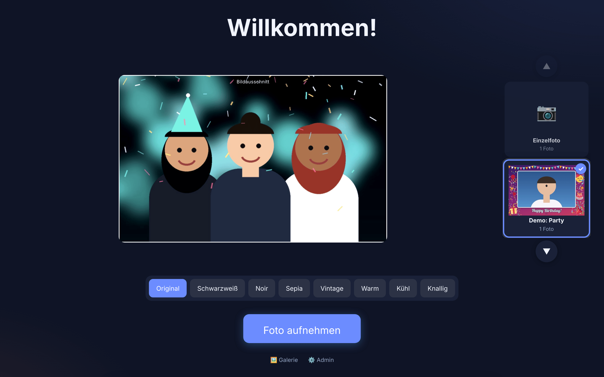

---

## Warum diese Box

- **Läuft ohne Internet.** WLAN-Ausfall auf der Hochzeit? Egal. Aufnehmen,
  drucken, Galerie, USB-Export — alles lokal. Online-Dienste sind Zugabe, nie
  Voraussetzung.
- **Ein Rechner, keine Cloud-Abos.** Ein gebrauchter Mini-PC reicht. Keine
  Lizenzschlüssel, keine Bilder auf fremden Servern.
- **Für Vermieter gebaut.** Ein eingeschränkter *Mieter*-Login lässt Kunden ihre
  Veranstaltung selbst einrichten, ohne an Netzwerk, Zahlung oder System zu kommen.
- **Modular.** Kamera, Auslöser, Ausgabe und Bezahlung sind austauschbare Module.
  DSLR oder Webcam, Touch oder Klingelknopf, Druck oder QR — kombinierbar.
- **Erklärt sich selbst.** Das komplette Bedienhandbuch steckt in der Oberfläche
  unter **Hilfe** — es liegt immer auf der Box und passt zur installierten Version.

> Zielgerät: x86_64-Mini-PC mit Ubuntu 24.04 (läuft grundsätzlich auch auf
> Raspberry Pi OS / anderen Linuxen).

**Wo steht was:** Diese Seite beschreibt, was die Box kann und wie ein Abend damit
abläuft. Wer sie **aufsetzen oder betreiben** will, findet alles Technische in der
[Installations- und Betriebsanleitung](docs/INSTALLATION.md).

---

## So läuft ein Abend

**1 · Look wählen, dann posieren.** Schwarzweiß, Noir, Sepia, Vintage, warm, kühl
oder knallig. Die Live-Vorschau zeigt den Look sofort — man sieht vorher, was
hinterher herauskommt.

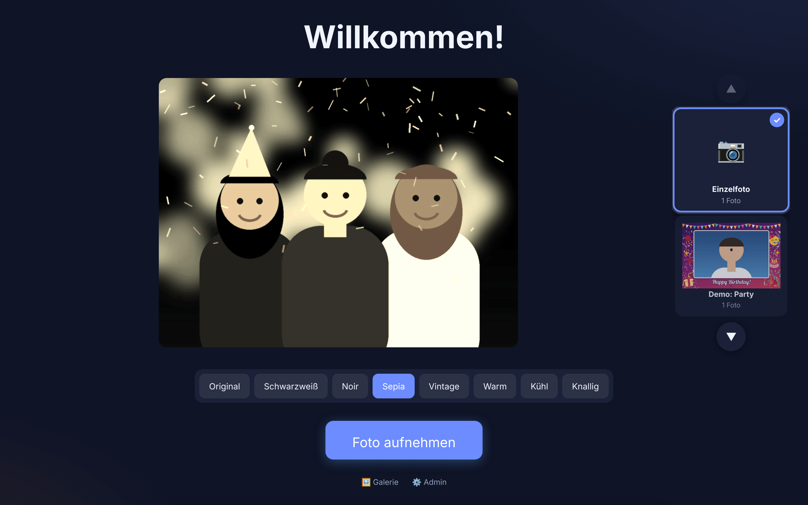

**2 · Layout wählen.** Einzelfoto oder Mehrbild-Streifen — was du für die
Veranstaltung freigegeben hast. Die Layouts stehen als Leiste direkt neben dem
Live-Bild auf dem Startbildschirm: antippen, und der Rahmen im Live-Bild zeigt
gleich den passenden Ausschnitt; „Foto aufnehmen“ startet. Jede Karte zeigt das
**fertig gerenderte Layout** mit Rahmen, Text und durchnummerierten Plätzen, nicht
bloß ein Symbol. Wer lieber einen eigenen Auswahl-Bildschirm will, stellt das in
den Einstellungen um (so sieht er aus):

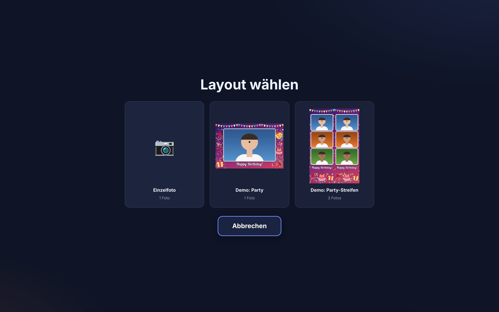

Zum Ausprobieren liegen zwei fertige **Demo-Vorlagen „Party“** bei (Rahmen 10×15
quer und Doppel-Streifen mit drei Aufnahmen) — sie sind auf diesen Bildern zu sehen
und im Vorlagen-Editor frei änderbar. Eingespielt werden sie auf der Box mit
`.venv/bin/python scripts/install-demo-template.py`.

**3 · Countdown.** Mit Piepton, Auslöse-Klick und Weißblende. Der Auslöse-Vorlauf
gleicht die Verzögerung der Kamera aus, damit das Foto exakt bei „0" entsteht.

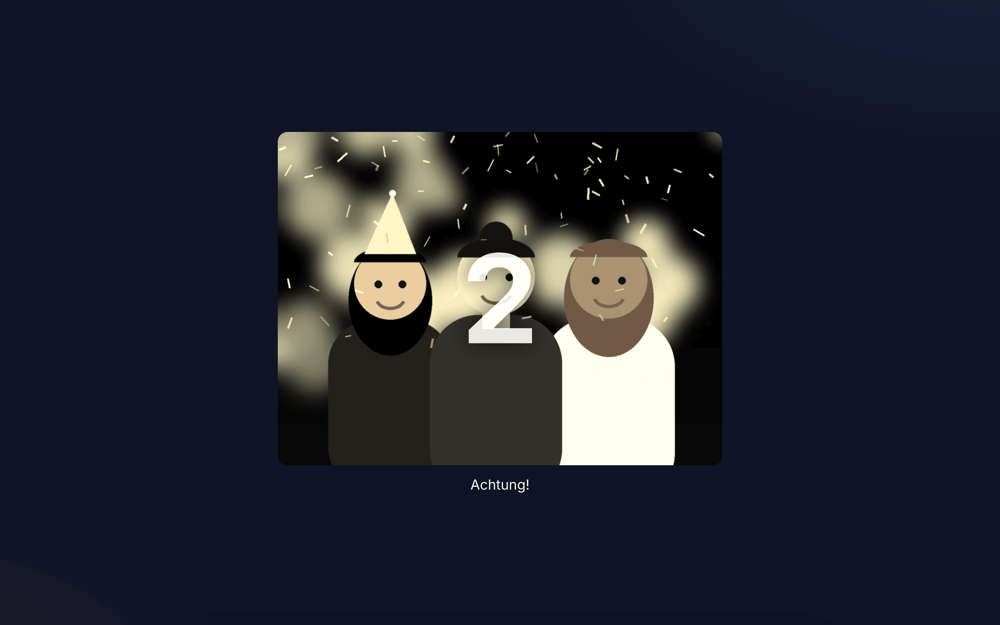

**4 · Ansehen — und verewigen.** Nicht gefallen? *Nochmal*. Sonst über
*Grußwort & Emojis*: mit dem Finger aufs Foto malen, Emoji-Sticker draufsetzen
(verschieben, größer, kleiner, drehen) und ein Grußwort dazuschreiben. Links das
Foto, rechts die Werkzeuge. Das digitale Gästebuch.

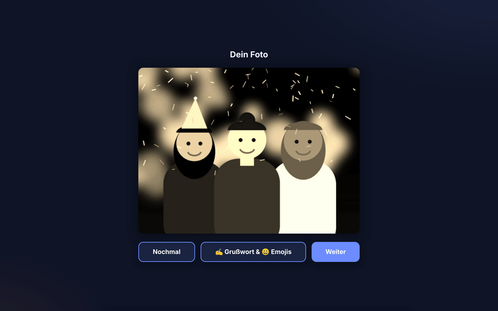

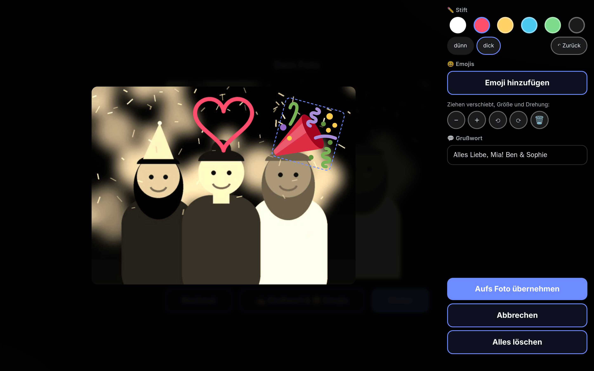

**5 · Mitnehmen.** Drucken, per QR aufs Handy, E-Mail, Bluetooth, USB-Stick oder
auf CD/DVD gebrannt. Und alles landet in der Galerie.

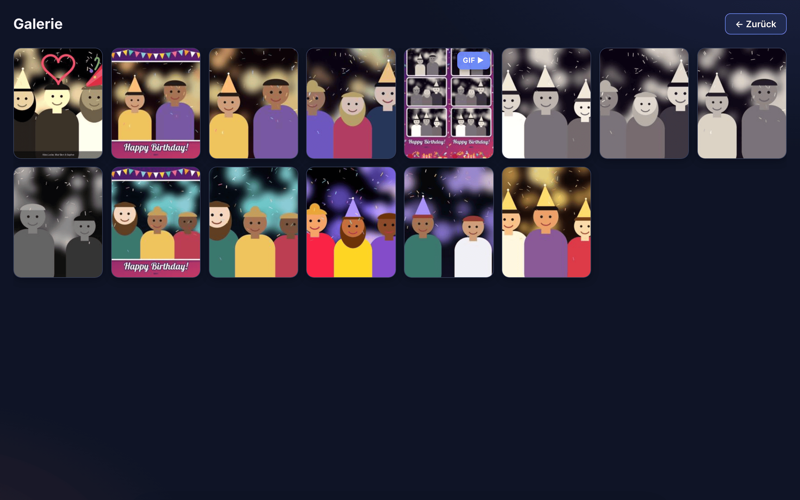

---

## Was die Box kann

**Aufnehmen**
- DSLR über gPhoto2 (Linux) oder digiCamControl (Windows), USB-Webcam über
  OpenCV, oder die Kamera des Browsers — auch getrennt für Vorschau und Aufnahme
  (Webcam zeigt live, DSLR schießt).
- Auslöser: Touch, GPIO-Knopf, Tastatur, seriell, Bluetooth oder Klatschen.
- Drehen und Spiegeln für schräg montierte Kameras. Getrennt davon der
  **Spiegel-Effekt**: Gäste sehen sich wie im Spiegel und posieren richtig herum,
  das gespeicherte Foto bleibt seitenrichtig — Schrift und Logos bleiben lesbar.
- **Scharfstell-Assistent** für den Aufbau: Autofokus auslösen, bei der
  Spiegelreflex den Objektivschalter auf MF, Schärfe in der Lupe oder am Testfoto
  prüfen — Schritt für Schritt unter Admin → Kameras.
- Hintergrund ersetzen per Greenscreen oder KI-Freisteller.
- **Animiertes GIF** aus den Sekunden vor dem Auslösen, wahlweise als
  **Boomerang** (vorwärts und wieder rückwärts). Das GIF entsteht im Hintergrund —
  Gäste sehen ihr Foto, ohne darauf zu warten.

**Gestalten**
- Vorlagen-Editor mit frei platzierbaren Foto-Slots, Rahmen, Logos, Text
  (Schriftart, Kontur, Drehung) und **Emojis** — direkt auf dem Touchscreen
  bedienbar. Emojis werden in voller Auflösung gerechnet und bleiben auch im Druck
  scharf.
- Ausgabe-Formate (10×15, A6, A4 …) bestimmen die Leinwandgröße der Vorlage.
- Jede Vorlage bekommt automatisch ein **Vorschaubild** — im Booth auf den
  Auswahlkarten und in der Vorlagenliste. Es wird beim Speichern erzeugt und
  erneuert sich von selbst, sobald du die Vorlage änderst.
- Ein Foto darf in mehreren Slots auftauchen: zwei Aufnahmen füllen ein
  Drei-Bilder-Layout.

**Ausgeben**
- Druck über CUPS mit **Papierstand-Überwachung** — die Box warnt und stoppt,
  bevor mitten in der Nacht das Papier ausgeht.
- **Drucker einrichten ohne CUPS-Kenntnisse:** USB-Drucker anstecken und
  einschalten — er wird automatisch eingerichtet. Netzwerkdrucker erscheinen im
  Admin-Bereich und werden mit einem Klick hinzugefügt. Fotodrucker
  (Thermosublimation, z. B. Mitsubishi CP9550DW-S) laufen über den mitgelieferten
  Gutenprint-Treiber.
- QR-Code aufs Gäste-Handy, E-Mail oder Bluetooth — beim Bluetooth-Versand sucht
  die Box Geräte in der Nähe, der Gast tippt seins an; vorheriges Koppeln ist
  nicht nötig. Umgekehrt nimmt die Box auch Dateien per Bluetooth entgegen.
- USB-Stick-Export und CD/DVD-Brennen für die Übergabe an den Veranstalter.
- Online-Galerie: spiegelt jedes neue Foto auf einen eigenen Server.
- **Galerie-Sichtschutz** für größere Feiern (wahlweise): Wer gerade fotografiert,
  sieht seine Bilder scharf; die Fotos früherer Gruppen zeigt die Galerie nach einer
  Pause nur weichgezeichnet.

**Verwalten**
- Mehrere Veranstaltungen, jede mit eigenen Vorlagen und eigenem Standort.
- **Metadaten**: Veranstaltungsname, Ort, GPS-Koordinaten, Aufnahmezeit und
  Kameramodell landen in den EXIF-Daten jedes Fotos, jeder Collage und jedes
  Thumbnails; GIFs bekommen dieselben Angaben als Kommentar. Die Bilddaten selbst
  bleiben dabei unangetastet — es wird nichts neu komprimiert.
- Bezahlung per SumUp (QR oder Terminal) oder Münzprüfer, wenn die Box Geld
  verdienen soll.
- Telegram-Benachrichtigungen: Hilfe-Knopf im Booth und Warnung bei leerem Drucker.
- **WLAN mit mehreren bekannten Netzen** (z. B. Zuhause, Location, Handy-Hotspot)
  samt Priorität — die Box verbindet sich selbst mit dem besten verfügbaren.
- **Fernwartung über Tailscale:** ist vorinstalliert, angemeldet wird im
  Admin-Bereich per Link oder QR-Code — ganz ohne Terminal.
- Nach einem Software-Update lädt sich die Oberfläche am Kiosk-Bildschirm von
  selbst neu.
- Eingebauter **Selbsttest** prüft Kamera, Datenbank, Drucker, Auslöser und
  Bildverarbeitung auf Knopfdruck.

---

## Die Steuerung

Alles über den Browser — vom Handy, Tablet oder direkt am Touchscreen der Box.
Das Menü ist nach dem Ablauf einer Veranstaltung nummeriert, **1 bis 6**: von der
Veranstaltung über Bilder, Layouts, Aufnahme und Drucken bis zu „Vor Ort &
danach“ (WLAN, USB-Stick). Unten schaltet **🐒 Einfach / 👷 Experte** um: Im
einfachen Modus steht nur, was man für eine Veranstaltung braucht; der
Expertenmodus zeigt zusätzlich Netzwerk, Auslöser, Module, Bezahlung und Co.

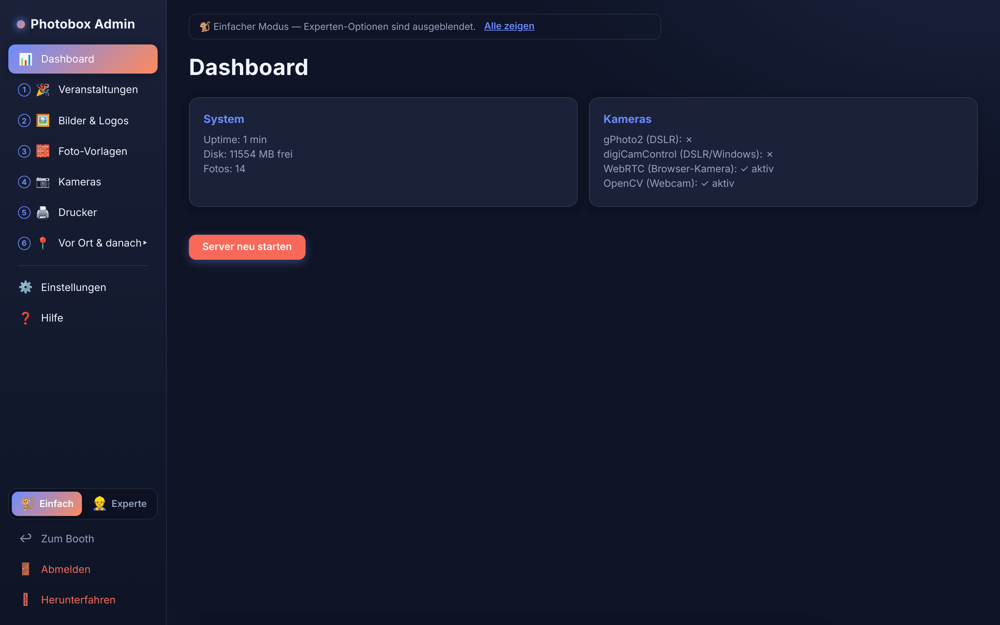

Die Kamera-Einstellungen (im Expertenmodus) mit Drehung, Spiegelung und dem
Spiegel-Effekt:

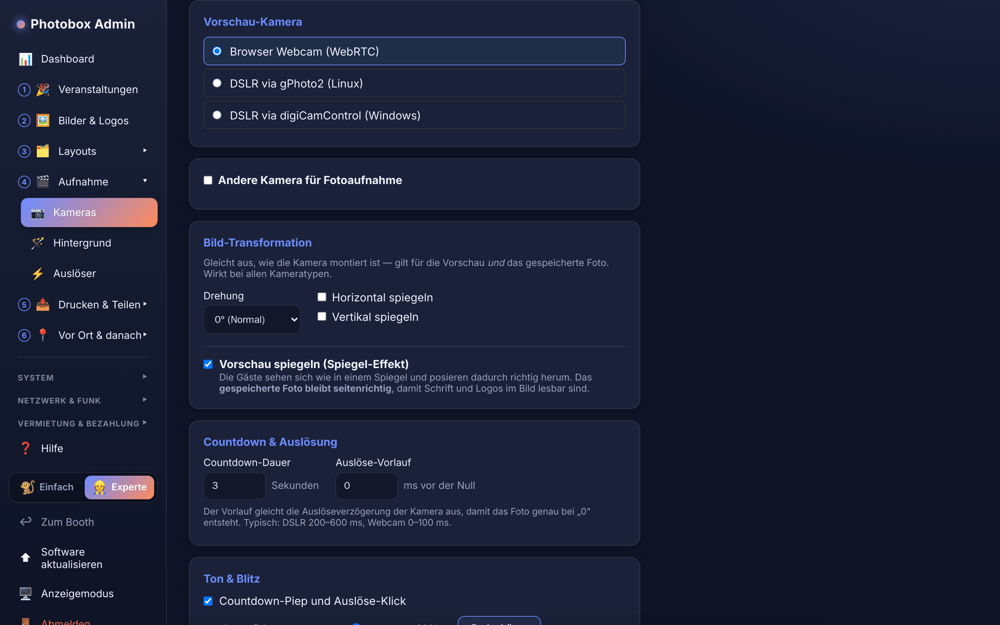

Veranstaltungen — inklusive Standort, der in die Fotos geschrieben wird:

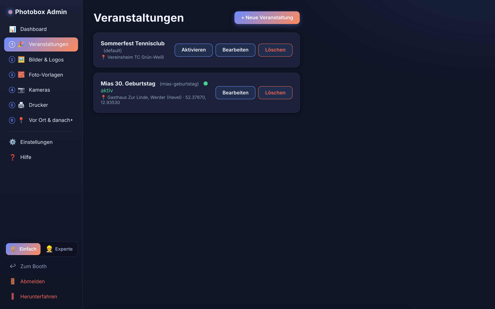

Die Foto-Vorlagen, jede mit automatisch erzeugtem Vorschaubild:

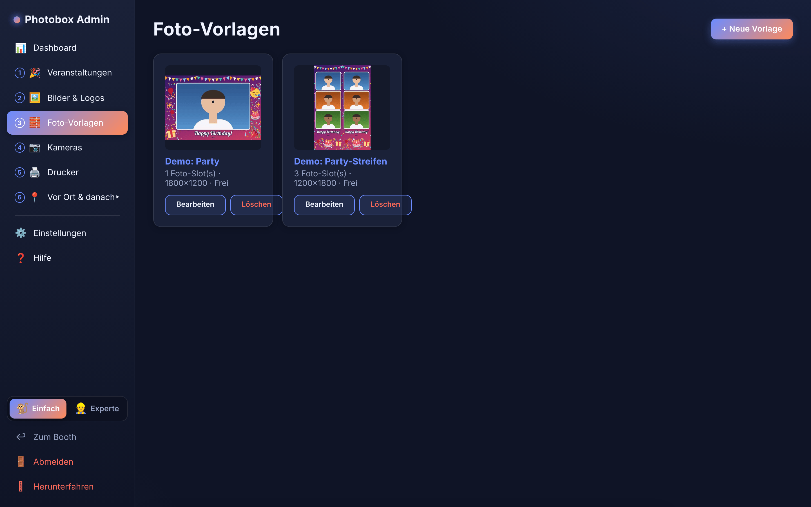

Und das Handbuch, das immer auf der Box liegt:

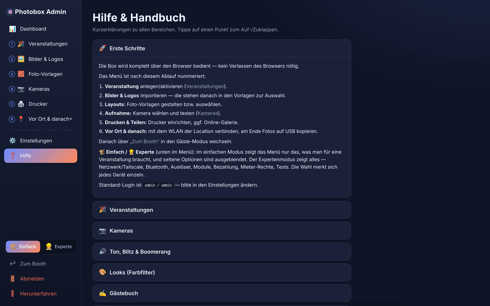

---

## Installation

Die Box läuft auf einem Mini-PC mit Linux. Aufsetzen, Aktualisieren, Fernzugang
und die üblichen Stolpersteine stehen in der
**[Installations- und Betriebsanleitung](docs/INSTALLATION.md)**.

Kurzfassung für Ungeduldige:

```bash
git clone https://github.com/mkrasselt1/mkphotobox.git
cd mkphotobox
sudo ./scripts/setup.sh
```

Danach läuft die Box auf Port **8080**, Login `admin` / `admin`.

---

## Zu den Bildern in diesem README

Die Screenshots zeigen die echte Oberfläche. Die abgebildeten „Gäste" sind
allerdings keine Fotos, sondern mit Pillow gezeichnete Illustrationen aus
[`docs/media/demo/`](docs/media/demo/) — sie stammen aus diesem Repository, zeigen
keine realen Personen und sind damit uneingeschränkt frei verwendbar.

Erzeugt werden die Bilder mit [`scripts/docs-screenshots.sh`](scripts/docs-screenshots.sh):
Es startet die Box mit eigener, frischer Datenbank in Docker, legt eine
Beispiel-Veranstaltung mit den Demo-Vorlagen an und fotografiert Booth, Galerie und
Admin-Bereich mit einem Headless-Browser. Als Kamera dient dessen Test-Kamera mit
einem der Demo-Bilder — Live-Bild, Countdown und Aufnahme sind also echt.

---

## Lizenz

TBD.

**Fremde Inhalte:** Die Emoji-Grafiken sind
[Twemoji](https://github.com/jdecked/twemoji) — © Twitter, Inc., jdecked und
weitere Mitwirkende, lizenziert unter
[CC-BY 4.0](https://creativecommons.org/licenses/by/4.0/). Sie liegen nicht im
Repository, sondern werden beim Setup heruntergeladen
(`scripts/install-emoji.sh`); beim Rendern werden sie nur skaliert und gedreht.
Details: [`app/assets/emoji/README.md`](app/assets/emoji/README.md).
Die mitgelieferten Demo-Rahmen in `app/assets/demo/` (Vorlagen „Demo: Party“)
enthalten gerenderte Twemoji-Grafiken unter derselben Lizenz; Farbverlauf,
Konfetti und Wimpelkette sind selbst gezeichnet
([`app/assets/demo/README.md`](app/assets/demo/README.md)).
